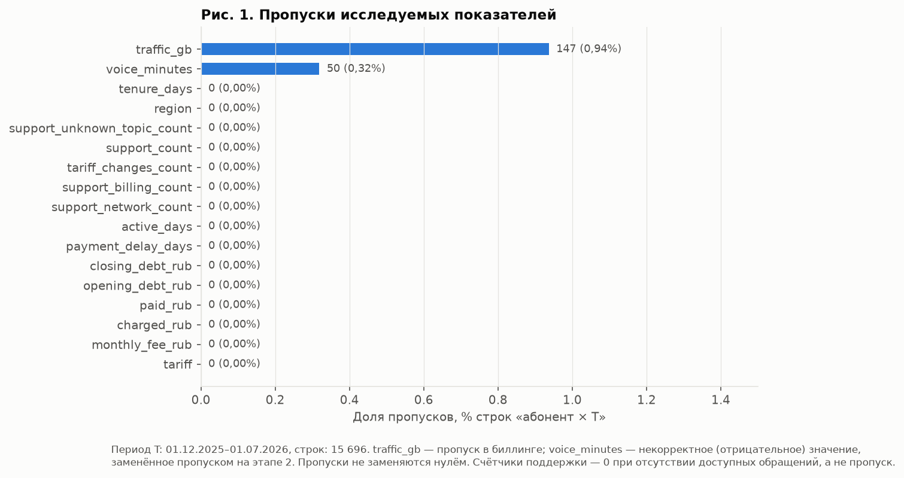
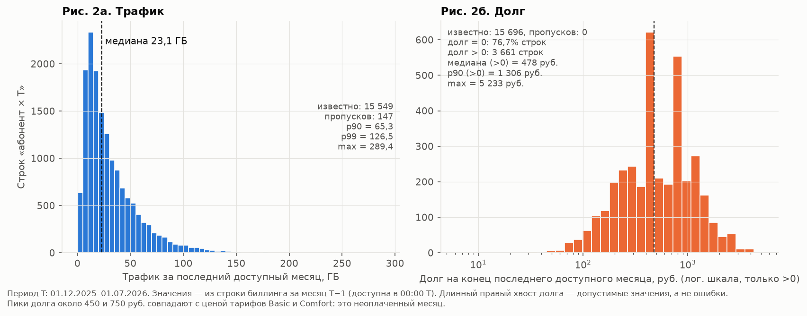
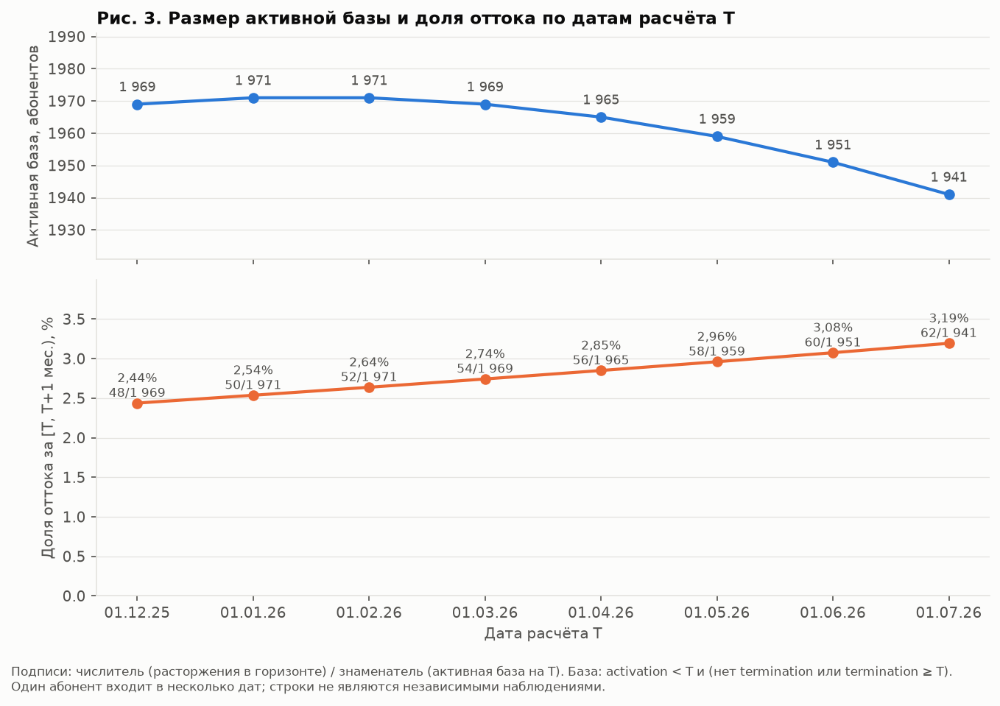
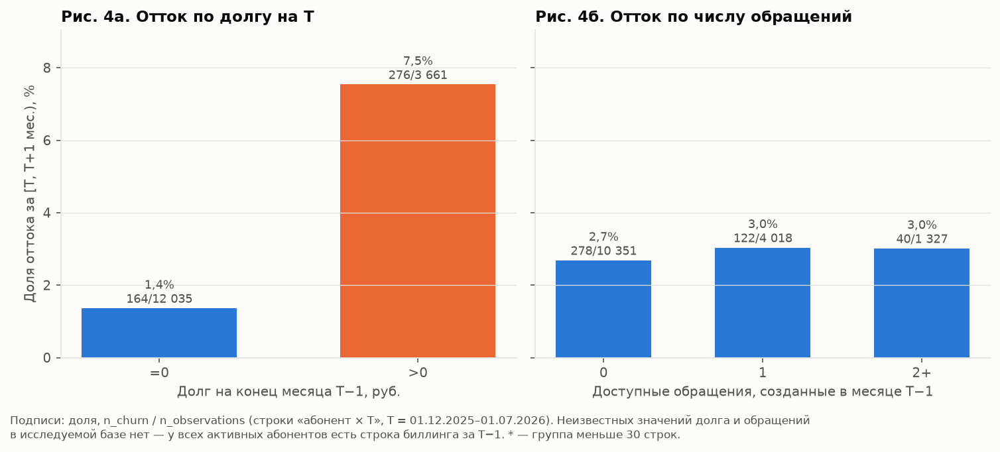
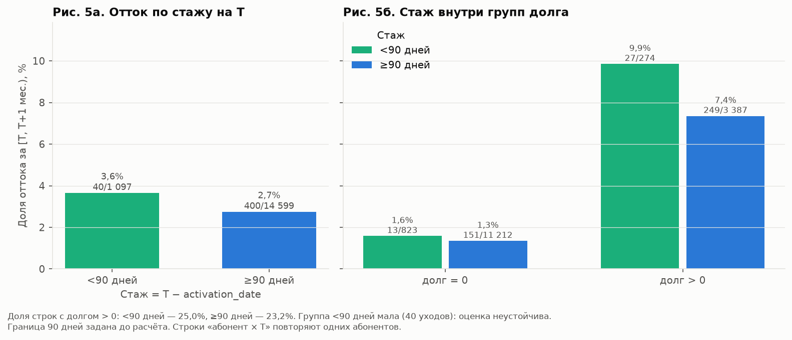
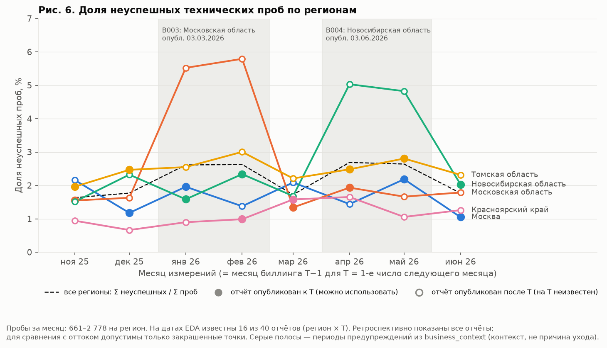

# Отчёт по разведочному анализу (этап 3)

**Команда:** Пустовой Михаил, Вушанло Фарух, Пилявец Екатерина, Дедков Вячеслав
**Версия репозитория:** тег `stage-3`
**Дата запуска:** 23.10.2026
**Команда запуска:** `python -m src.eda` (после `python -m src.prepare`)

Рисунки лежат в [`reports/eda/figures`](../reports/eda/figures), расчётные таблицы — в [`reports/eda/tables`](../reports/eda/tables). Журнал гипотез: [`reports/eda/analysis_plan.csv`](../reports/eda/analysis_plan.csv). Исследовательская таблица: [`data/eda/eda_sample.csv`](../data/eda/eda_sample.csv), её словарь — `eda_sample_dictionary.csv`.

## 1. Цель и исследуемая база

**Вопросы исследования** (вводная заказчика):

1. Как меняется доля оттока и размер активной базы?
2. Отличается ли отток у абонентов с долгом и без него?
3. Связаны ли обращения в поддержку с последующим уходом?
4. Различаются ли группы по стажу (а также по тарифу и региону)?
5. Что дают технические измерения сети и можно ли их использовать на дату расчёта?

| Параметр | Принятое правило |
|---|---|
| Единица наблюдения | Строка «абонент × T», ключ `(customer_id, snapshot_at)` |
| Даты T для EDA | 1-е число месяца, 01.12.2025 – 01.07.2026 (8 дат) |
| Валидация и тест | 01.08.2026 и 01.09.2026. Снимки и метки для них в этом этапе **не строились и не просматривались** |
| Активная база и границы T | `activation_date < T` и (нет расторжения или `termination_date ≥ T`): состояние перед событиями дня T. Подключившиеся в день T не входят; расторгнувшие в день T входят с меткой 1 |
| Горизонт и исключённый конец | Календарный месяц `[T, T + 1 мес.)`. `target_end_exclusive` = 1-е число следующего месяца. Если конец > 01.10.2026, метка неизвестна (на EDA-датах таких нет) |
| Источники признаков и их доступность | Строка `customer_month` с `available_at ≤ T` (в стандартном комплекте — месяц T−1, `source_billing_month` сохранён). Поддержка — агрегаты этой строки (обращения с `available_at ≤ T`). Постоянные поля справочника. Сеть — отдельная таблица `network_availability.csv`, только при `report_available_at ≤ T` |

Метка формируется отдельным шагом (`snapshots.add_target`), после построения признаков (`snapshots.build_features`). Дата расторжения в признаки не попадает.

**Итог:** 15 696 строк, 2 319 уникальных абонентов, 440 наблюдаемых уходов (2,80%). Неизвестных меток нет.

Абоненты с короткой историей сохранены: у 784 строк доступно 1–2 месяца биллинга. Пропусков ключевых полей из-за отсутствия строки биллинга нет: у каждого активного на T абонента есть строка за T−1.

## 2. Распределения и качество

### Рисунок 1 — пропуски



Таблица: `fig1_missing.csv`.

- `traffic_gb` пропущен в 147 строках (0,94%), `voice_minutes` — в 50 (0,32%). Остальные исследуемые поля заполнены.
- Пропуск трафика — неизвестное значение в источнике. Пропуск минут — некорректное отрицательное значение, заменённое на этапе 2. Ни то ни другое не заменяется нулём.
- При расчёте статистики по полю такие строки исключаются, число известных значений указано в `fig2_numeric_summary.csv`.

### Рисунок 2 — распределения трафика и долга



Таблицы: `fig2_numeric_summary.csv`, `category_frequencies.csv`.

**Трафик** (15 549 известных значений):

- Медиана 23,1 ГБ, p25 = 12,7, p90 = 65,3, p99 = 126,5, максимум 289,4 ГБ.
- Нулей нет, минимум — 0,15 ГБ.
- Длинный правый хвост правдоподобен для мобильного интернета и сохранён.

**Долг на конец месяца:**

- 76,7% строк имеют нулевой долг. Это содержательный ноль: оплачено полностью.
- Среди долгов > 0 (3 661 строка): медиана 478 ₽, p90 = 1 306 ₽, максимум 5 233 ₽.
- Пики около 450 и 750 ₽ совпадают с ценой тарифов Basic и Comfort — это один неоплаченный месяц.
- Крупные значения допустимы: долг накапливается за несколько месяцев, а `opening + charged − paid = closing` выполняется во всех строках.

**Другие нули с содержательным смыслом:**

- `paid_rub = 0` в 11,7% строк: во всех таких строках `payment_delay_days` равен длине месяца, то есть оплаты не было.
- `support_count = 0` в 65,9% строк: нет доступных корректно связанных обращений.
- `tariff_changes_count = 0` в 96,5% строк.

**Категории:**

- Тарифы: Basic 6 239, Comfort 6 286, Premium 3 171 строк.
- Регионы: по 3 027–3 197 строк.
- Сегмент small_business — 1 225 строк.

## 3. Динамика и различия групп

### Рисунок 3 — доля оттока и активная база по T



Таблица: `fig3_churn_by_T.csv` (числитель, знаменатель и независимый пересчёт базы).

- Доля оттока растёт на каждой дате: 2,44% (48 / 1 969) на 01.12.2025 → 3,19% (62 / 1 941) на 01.07.2026.
- Активная база с февраля сокращается: 1 971 → 1 941. Подключения (около 50 в месяц) не компенсируют растущее число расторжений.
- Это согласуется с легендой заказчика (рост с 2,1% до 3,4%). Модель должна учитывать дрейф базовой доли.

### Рисунок 4 — отток по долгу и обращениям



| Группа | Строк | Абонентов | Уходов | Доля |
|---|---:|---:|---:|---:|
| Долг = 0 | 12 035 | 2 241 | 164 | 1,36% |
| Долг > 0 | 3 661 | 1 784 | 276 | 7,54% |
| Обращений 0 | 10 351 | 2 278 | 278 | 2,69% |
| Обращений 1 | 4 018 | 1 867 | 122 | 3,04% |
| Обращений 2+ | 1 327 | 962 | 40 | 3,01% |

Группы «неизвестный долг» и «неизвестное число обращений» пусты: у всех строк есть биллинг за T−1.

**Проверка альтернативных объяснений для долга** (`fig4_churn_by_debt_within_T.csv`, `fig4_churn_by_debt_within_tariff.csv`):

- **Внутри каждой из 8 дат:** долг > 0 даёт 5,7–8,9% ухода, долг = 0 — 1,1–1,6%.
- **Внутри тарифов:** Basic 6,3% против 1,4%, Comfort 7,8% против 1,4%, Premium 9,2% против 1,2%.
- **Внутри групп стажа:** см. рис. 5б.

Связь не объясняется месяцем, тарифом или стажем.

Ещё сильнее выделяются строки без оплаты (`payment_delay_days` 28–31, `paid_rub = 0`): 10,55% ухода (193 / 1 829) против 1,41% при своевременной оплате (`extra_churn_by_payment_delay.csv`).

**Обращения:**

- По общему числу обращений различие не больше 0,35 п.п.
- По теме «качество связи»: 2,81%, 2,84%, 2,15% (6 / 279).
- По теме «оплата»: 2,86%, 2,41%, 2,34%.

Устойчивой связи нет.

### Рисунок 5 — стаж (выбранный сегмент)



Таблицы: `fig5_churn_by_tenure.csv`, `fig5_churn_by_tenure_within_debt.csv`. Граница 90 дней задана до расчёта.

- **Стаж < 90 дней:** 3,65% (40 / 1 097 строк, 445 абонентов). **Стаж ≥ 90 дней:** 2,74% (400 / 14 599).
- Внутри долга = 0: 1,58% против 1,35%. Внутри долга > 0: 9,85% против 7,35%.
- Доля строк с долгом почти одинакова (25,0% и 23,2%), поэтому разница не объясняется составом по долгу.
- Но группа мала: всего 40 уходов. Разница в 0,9 п.п. при таком объёме неустойчива.

**Дополнительно** (`extra_churn_by_tariff.csv`, `extra_churn_by_region.csv`):

- **Тарифы:** Premium 3,12%, Comfort 2,96%, Basic 2,48%. Различие в основном сосредоточено в группе с долгом.
- **Регионы:** Красноярский край 3,20% и Москва 3,16% против 2,45–2,64% в остальных.

**Повторные наблюдения.** Один абонент входит в среднем в 6,8 даты. Доли считаются по строкам, а не по людям. Простые тесты независимых строк завышали бы уверенность, поэтому формальная значимость не заявляется.

## 4. Сеть и контекст

### Рисунок 6 — доля неуспешных проб по регионам



Таблицы: `fig6_network_by_region.csv`, `fig6_network_total.csv`, `data/eda/network_availability.csv`.

**Правило агрегирования проб:**

- Доля региона за месяц — `failed_probe_count / probe_count`.
- Для нескольких регионов — `Σ failed_probe_count / Σ probe_count` (пунктир на рисунке).
- Доли не усредняются, общие p50/p90 из региональных не выводятся.

**Доступность отчётов на T:**

- Месяц измерений = месяц T−1. Из 40 пар «регион × T» на датах EDA отчёт известен в **16** (опубликован ровно в 00:00 T). В 24 парах он опубликован через 24–48 ч после T и на T неизвестен.
- В таблице доступности значение для них оставлено пропуском; отчёт следующего месяца не подставляется.
- На рисунке закрашенные точки — известные на T отчёты, полые — опубликованные позже (показаны ретроспективно).

**Что видно:**

- Всплески доли ошибок: Московская область в январе–феврале 2026 (5,5–5,8%), Новосибирская область в апреле–мае 2026 (4,8–5,0%). Остальные значения — 0,7–3,0%.
- Связи с оттоком на уровне региона нет. У Красноярского края самая низкая доля ошибок за 12 месяцев (1,22%), но самый высокий отток (3,20%). У Московской области — 2,60% ошибок и 2,64% оттока.
- Среди строк с известным отчётом: при доле ошибок выше медианы (1,95%) отток 2,80%, при доле не выше медианы — 3,06% (`fig6_churn_by_known_fail_level.csv`).

**Что даёт календарь событий** (`business_context_timeline.csv`, не присоединяется к абонентам):

- **B001** — переход поддержки 01.11.2025. Число обращений до и после сопоставимо: 714 и 871 в сентябре–октябре, 873–976 в месяцах новой системы.
- **B002, B005** — праздничный и летний периоды, объявлены заранее.
- **B003 и B004 опубликованы после описанного периода:** предупреждение о январе–феврале появилось 03.03.2026, об апреле–мае — 03.06.2026. На T внутри этих периодов сообщение было неизвестно, поэтому как исторический признак его использовать нельзя.

**Ограничения:**

- Пробы — технические загрузки, их число не равно числу абонентов. Выборка не случайна.
- Региональная доля ошибок не равна доле абонентов с плохой связью.
- Пять регионов дают слишком мало точек для вывода о связи с индивидуальным уходом. Сходство линий не доказывает причинность.

## 5. Результаты гипотез

Подробно — в [`reports/eda/analysis_plan.csv`](../reports/eda/analysis_plan.csv).

| Гипотеза | Результат и числа | График/таблица | Ограничение | Следующее действие |
|---|---|---|---|---|
| H1 Долг | **Поддерживается.** 7,54% (276 / 3 661) против 1,36% (164 / 12 035). Сохраняется внутри всех T, тарифов и групп стажа | Рис. 4а, `fig4_churn_by_debt*.csv` | Связь, а не причина: долг и уход могут иметь общую причину (отказ от услуг) | Признаки долга и оплаты. Сравнение модели с правилом «долг > 0» |
| H2 Поддержка | **Не поддерживается.** 2,69% / 3,04% / 3,01% для 0 / 1 / 2+. По темам разница ≤ 0,7 п.п. и в разные стороны | Рис. 4б, `fig4_churn_by_*support.csv` | Окно в один месяц; 0 — нет доступных записей, а не отсутствие обращений | Проверить 3-месячные окна и оценки. Не рассчитывать на сильный сигнал |
| H3 Время | **Поддерживается.** Рост 2,44% → 3,19% на всех 8 датах, база 1 971 → 1 941 | Рис. 3, `fig3_churn_by_T.csv` | 8 точек: тренд и сезонность не разделить | Валидация на более поздних T, контроль дрейфа базовой доли |
| H4 Стаж | **Данных недостаточно.** 3,65% (40 / 1 097) против 2,74%. Направление сохраняется внутри групп долга | Рис. 5, `fig5_*.csv` | 40 уходов; повторные наблюдения | Стаж и длина истории как признаки, оценка на валидации |

## 6. Переход к признакам

| Направление | Смысл | Источник | Доступность на T | Риск |
|---|---|---|---|---|
| 1. Долг и платёжная дисциплина | Текущий долг, нулевая оплата, задержка, рост долга за 3 месяца, число месяцев с долгом | `billing_clean` / `customer_month` | Строки с `available_at ≤ T` (по месяц T−1) | Низкий при соблюдении правила. Не использовать биллинг месяца T: он доступен только с T+1 |
| 2. Динамика потребления | Трафик и минуты за T−1 относительно среднего за 3 месяца, флаги пропусков. У ушедших медианы ниже: 21,7 против 23,1 ГБ, 222 против 251 мин | `customer_month` | `available_at ≤ T` | Пропуск ≠ 0. Медианы для импутации считать только на обучающих датах. У новых абонентов окно короче |
| 3. Стаж, история и тариф | `tenure_days`, `billing_months_available`, тариф, смена тарифа, регион | `subscribers_clean`, `customer_month` | Постоянные поля и даты < T | Регион и тариф могут отражать состав группы, а не риск. Длина истории связана с датой T (для ранних T история короче) |

Обращения и сеть остаются кандидатами второго ряда:

- обращения — с учётом `resolution_available_at`;
- сеть — только известные на T отчёты (в 60% пар «регион × T» значение будет пропуском).

## 7. Проверки и воспроизводимость

```bash
python -m src.prepare
python -m src.eda
python -m pytest
```

**Версии:** Python 3.13.15, pandas 3.1.0, numpy 2.5.4, matplotlib 3.11.2. Параметры периода, горизонта и базы — в `src/config.py` и `reports/eda/run_config.json`.

| Проверка | Результат | Где воспроизвести |
|---|---|---|
| Уникальность ключа и сохранность активной базы | OK: 15 696 уникальных ключей. Число строк по каждой T совпадает с базой, пересчитанной напрямую из сырого `contract_events.csv` | `reports/eda/checks.csv` |
| Информация доступна на T | OK: `billing_available_at ≤ snapshot_at` во всех строках, `source_billing_month = T−1`. Метка и дата расторжения не входят в признаки | `checks.csv`, `test_features_use_only_rows_available_at_T` |
| Граничные события и конец горизонта | OK: подключение в день T не входит в базу; расторжение в день T — в базе с меткой 1; расторжение ровно на конце горизонта — метка 0; конец позже 01.10.2026 — метка неизвестна | `reports/eda/boundary_example.csv`, `tests/test_eda.py` |
| Поздний сетевой отчёт | OK: 24 из 40 отчётов опубликованы после T и на T неизвестны (значение — пропуск) | `checks.csv`, `test_late_network_report_unknown_at_snapshot` |
| Групповые суммы и знаменатели | OK: для T, долга, обращений, стажа, тарифа, региона и стажа × долг суммы n и уходов равны 15 696 и 440 | `checks.csv` |
| Повторный запуск | OK: два запуска дают побайтно одинаковые CSV (SHA-256), все 6 рисунков создаются без ручных правок | `run_config.json` (хэш `eda_sample.csv`) |

**Вклад участников:**

| Участник | Задача | Подтверждаемый результат |
|---|---|---|
| Пилявец Екатерина (исследователь данных) | План гипотез, исследовательская таблица, шесть рисунков, связи с оттоком, сеть и контекст | `src/eda.py`, `reports/eda/figures/`, `reports/eda/tables/`, `reports/eda/analysis_plan.csv` |
| Вушанло Фарух (инженер по данным) | Снимки «абонент × T»: активная база, признаки на T, отдельная метка, таблица доступности сетевых отчётов | `src/snapshots.py`, `data/eda/` |
| Дедков Вячеслав (разработчик модели) | Проверки граничных событий, доступности и знаменателей; направления признаков для этапа 4 | `tests/test_eda.py`, `reports/eda/checks.csv`, раздел 6 |
| Пустовой Михаил (аналитик, оформление) | Выводы для заказчика, отчёт EDA, репозиторий | этот отчёт, `README.md` |

**Нерешённые ограничения:**

- Один год данных.
- Повторные наблюдения не позволяют формально оценивать значимость.
- Сетевые данные агрегированы по 5 регионам.
- Эффект удерживающего контакта не оценивается.
- Выводы EDA не проверялись на валидационных и тестовых датах — это сделано намеренно.
